# 22. ERD v1

```mermaid
erDiagram
 USER ||--o{ USER_ATHLETE : links
 ATHLETE ||--o{ USER_ATHLETE : links
 USER ||--o| TRAINER_PROFILE : has
 BRANCH ||--o{ HALL : contains
 GROUP ||--o{ GROUP_TRAINER : has
 TRAINER_PROFILE ||--o{ GROUP_TRAINER : assigned
 GROUP ||--o{ GROUP_MEMBERSHIP : contains
 ATHLETE ||--o{ GROUP_MEMBERSHIP : joins
 GROUP ||--o{ SCHEDULE_TEMPLATE : owns
 SCHEDULE_TEMPLATE ||--o{ SCHEDULE_TEMPLATE_SLOT : contains
 GROUP ||--o{ TRAINING_SESSION : schedules
 HALL ||--o{ TRAINING_SESSION : hosts
 TRAINER_PROFILE ||--o{ TRAINING_SESSION : leads
 TRAINING_SESSION ||--o{ ATTENDANCE : records
 ATHLETE ||--o{ ATTENDANCE : receives
 TRAINING_SESSION ||--o{ PLANNED_ABSENCE : has
 ATHLETE ||--o{ PLANNED_ABSENCE : reports
 ATHLETE ||--o{ MEMBERSHIP_PERIOD : billed
 MEMBERSHIP_PERIOD ||--o{ PAYMENT_TRANSACTION : payments
 ATHLETE ||--o{ FREEZE_PERIOD : freezes
 USER ||--o{ NEWS_POST : authors
 NEWS_POST ||--o{ NEWS_COMMENT : comments
 USER ||--o{ NEWS_COMMENT : authors
 CONVERSATION ||--o{ CONVERSATION_MEMBER : members
 USER ||--o{ CONVERSATION_MEMBER : participates
 CONVERSATION ||--o{ MESSAGE : contains
 USER ||--o{ MESSAGE : sends
 USER ||--o{ USER_PERMISSION : grants
 PERMISSION ||--o{ USER_PERMISSION : defines
 USER ||--o{ AUDIT_LOG : acts
 ATHLETE ||--o{ CERTIFICATION : certifies
 USER ||--o{ CERTIFICATION : records
 USER ||--o{ DEBT_RULE : creates
```

## Notes
- Branch и Hall разделены, хотя MVP использует фактическую связь 1:1.
- GroupMembership сохраняется исторически; одновременно допускается одна активная запись на Athlete.
- MembershipPeriod идентифицируется athlete + year + month.
- FreezePeriod хранит effective dates отдельно от created_at/updated_at.
- TrainingSession — материализованный экземпляр занятия; изменения экземпляра не меняют ScheduleTemplate.
- **Certification** — событие аттестации (дата, ступень кю/дан, присвоенный пояс). Текущий пояс в карточке — производное от последней аттестации; отмена пересчитывает его.
- **DebtRule** — версии правил задолженности: действует версия с наибольшей `effective_from`, не превышающей расчетный месяц; прошлое менять нельзя (ADR-0014).
- **ClubProfile** — единственная строка (CHECK на `id = 'default'`): название, контакты, часовой пояс и срок оплаты месяца. Секретов в таблице нет.
