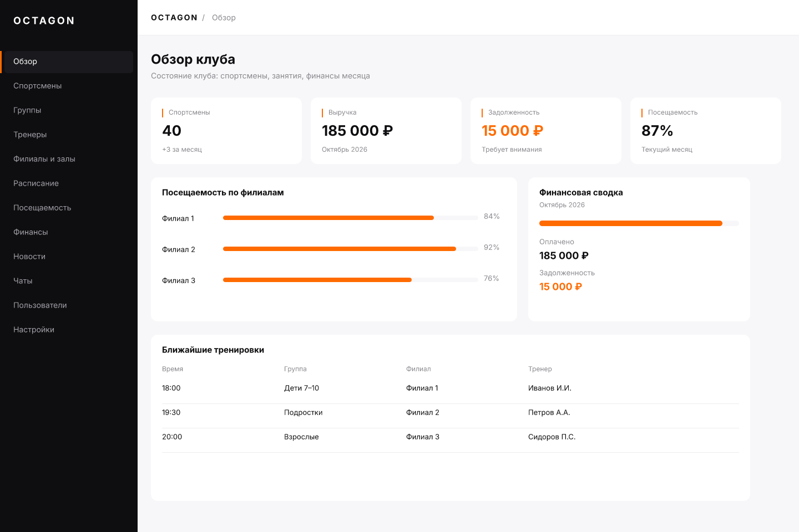

# Экраны в FigCraft

Как я создаю макеты без Figma: экран описывается командами, FigCraft выполняет их
без окна и рендерит PNG. Макет становится воспроизводимым: изменил число —
перегенерировал, и он снова совпадает с кодом.



## Что нужно

`figcraft-cli` из релиза [`storytold/figcraft`](https://github.com/storytold/figcraft)
(v0.10.0): в Windows-архиве `figcraft-0.10.0-windows-x64-portable.zip` рядом с
приложением лежит `figcraft-cli.exe`. Установка в систему не требуется.

```bash
# разложить релиз
unzip figcraft-0.10.0-windows-x64-portable.zip -d .tools/figcraft
CLI=.tools/figcraft/figcraft-0.10.0-windows-x64-portable/figcraft-cli.exe

# сгенерировать команды экрана и выполнить их
node docs/design/figcraft/build-dashboard.mjs
$CLI run docs/design/figcraft/dashboard.json --out docs/design/figcraft/dashboard.figcraft

# отрендерить PNG
$CLI export docs/design/figcraft/dashboard.figcraft -o docs/design/figcraft/dashboard.png
```

## Как устроен генератор

`build-dashboard.mjs` собирает массив шагов `{command, params}`:

- `frame.create` — фрейм 1440×960;
- `node.create` с `type: frame|rectangle|text` — сайдбар, плашка активного пункта,
  карточки, текст;
- ссылки на созданные слои идут через `{"$step": n}`: сначала создаётся
  родитель, потом дети. Номера id угадывать не нужно.

Палитра берётся из токенов проекта (`#FF6B00`, `#0E0E10`, `#F7F7F9`), поэтому
макет и интерфейс не расходятся по цветам.

## Что уже сделано

- `dashboard.figcraft` — дашборд админки: сайдбар 248 px без иконок, активный
  пункт с полосой, крошки, четыре KPI с подписью контекста, посещаемость по
  филиалам, финансовая сводка, ближайшие тренировки. 88 слоёв.
- `dashboard.json` — те же 88 команд в читаемом виде: по нему видно, какие
  координаты и размеры заданы.
- `dashboard.png` — рендер 1440×960.

## Что можно делать дальше

- **Остальные экраны** тем же способом: списки, карточки, диалоги, состояния.
- **Сравнение с кодом**: рендер FigCraft и скриншот админки кладутся рядом
  (1440 px), расхождения видно без «на глаз».
- **Правки в приложении**: открыть `.figcraft` в FigCraft, поправить руками,
  затем перенести значения обратно в генератор — или наоборот, менять генератор
  и проверять рендером.
- **Dev Mode**: FigCraft отдает React-код выделенного фрейма, но связать его с
  данными всё равно нужно вручную — генератор для этого и полезнее.

## Ограничения

- Текст рисуется шрифтами FigCraft; `--no-system-fonts` делает рендер одинаковым
  на любой машине.
- `.figcraft` — нативный формат, версионируется бинарником (25 КБ на экран).
  В git он лежит рядом с генератором: при расхождении генератор — источник истины.
